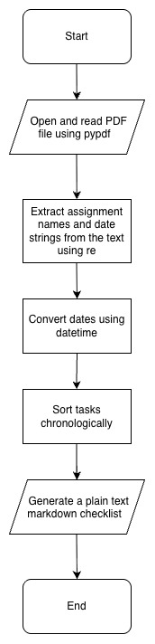

# syllabus-checklist

A Python command line tool that allows you to upload course syllabus PDFs and outputs a checklist of assignments sorted by deadline dates. 

## The Problem

Tracking assignments and their deadlines for different courses is tedious and scattered. Manually entering it into one place often leads to errors that can result in missed deadlines.

## How It Works

1. Uses argparse so users can directly input any PDF file path.
2. Reads the PDF and prints its raw text to terminal.
3. Uses re to extract assignment names and date strings from the text.
4. Uses datetime to parse the date strings to actual comparable date objects.
5. Sorts the tasks chronologically.
6. Outputs the tasks into a plain text markdown checklist.



[Eisenhower matrix](docs/CS 193 Final Project - Eisenhower Matrix.pdf)

## Tech Stack

- **Language:** Python
- **Libraries and Modules:** pypdf, datetime, re, argparse 

## Setup

Step-by-step: how does someone who just cloned your repo get it
running?

```bash
git clone https://github.com/aaryapillaiedu/syllabus-checklist
cd syllabus-checklist
```

## Roadmap

- [ ] Color code based on course 
- [ ] Automatically generates subtasks for each assignment
- [ ] The task disappears once marked complete

## Author

Aarya Pillai, https://github.com/aaryapillaiedu/syllabus-checklist
